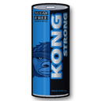
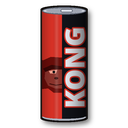
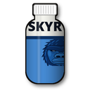
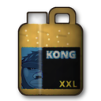

# Kong Strong Energy für Valheim

<p>
  
  
  
  
</p>

Ein Valheim-Mod mit vier Energydrinks im Stil von Kong Strong: Sie geben dir mehr Ausdauer, mehr Tempo und mit Skyr sogar mehr Tragkraft.

## Die Drinks

| Drink | Dauer | Wirkung |
| --- | --- | --- |
| **Kong Strong Sugar Free** (blau) | 5 Min. | +40 Sofort-Ausdauer, +50 % Ausdauer-Regeneration, +10 % Tempo, −25 % Ausdauerverbrauch beim Rennen und Springen |
| **Kong Strong Urban Classic** (rot, mit Zucker) | 3 Min. | +80 Sofort-Ausdauer, +75 % Ausdauer-Regeneration, +15 % Tempo, −25 % beim Rennen und Springen. **Danach 1 Min. Zuckercrash:** −25 % Ausdauer-Regeneration, −5 % Tempo |
| **Skyr Energy** (Protein-Drink) | 10 Min. | +20 Sofort-Ausdauer, +50 Tragkraft, +25 % Lebens- und Ausdauer-Regeneration |
| **Kong Strong XXL** (18,9-L-Kanister) | 20 Min. | Wirkung wie Sugar Free, dazu **feuerfest** (halber Feuerschaden). Wiegt 19 kg und stapelt nicht |

Es wirkt immer nur ein Kong-Drink auf einmal, und während des Zuckercrashs kannst du keinen neuen trinken. Mit Met lassen sich alle Drinks kombinieren.

## Herstellung

Alle Drinks werden am **Kessel** (Cauldron) gebraut. Den Kessel kannst du bauen, sobald du Zinn aus dem Schwarzwald hast, und er braucht ein Feuer darunter.

| Drink | Zutaten | Ergibt | Ab Biom |
| --- | --- | --- | --- |
| Sugar Free | 3 Blaubeeren, 1 Distel, 1 Gelber Pilz | 2 | Schwarzwald |
| Urban Classic | 2 Honig, 3 Himbeeren, 1 Blutbeutel, 1 Gelber Pilz | 2 | Sumpf |
| Skyr Energy | 1 Ei, 1 Honig, 2 Blaubeeren | 2 | Ebenen |
| XXL | 6 Vineberries, 3 Smoke Puffs, 3 Gelbe Pilze | 1 | Ashlands |

Sugar Free kommt ohne Honig aus, schließlich ist es zuckerfrei.

Alle Werte, Rezepte und Stationen lassen sich in der Config ändern (siehe [Konfiguration](#konfiguration)).

## Voraussetzungen

- [BepInExPack_Valheim](https://thunderstore.io/c/valheim/p/denikson/BepInExPack_Valheim/) 5.4.2333 oder neuer
- [Jotunn](https://thunderstore.io/c/valheim/p/ValheimModding/Jotunn/) 2.30.2 oder neuer

Im **Multiplayer** müssen alle Spieler und der Server den Mod in derselben Version haben, sonst verweigert Jotunn die Verbindung.

## Installation

Die fertige Mod gibt es auf der [Release-Seite](https://github.com/Stanni97/valheim-kong-strong/releases/latest) als `KongStrongEnergy-<version>.zip`. Darin liegen `plugins/KongStrong.dll` sowie `manifest.json` und `icon.png` für Mod-Manager.

### Mit Mod-Manager (Windows und Linux)

In [r2modman](https://thunderstore.io/c/valheim/p/ebkr/r2modman/) oder [Gale](https://thunderstore.io/c/valheim/p/Kesomannen/GaleModManager/):

1. Ein Valheim-Profil anlegen und darin **BepInExPack_Valheim** und **Jotunn** installieren.
2. Die Zip-Datei mit der Import-Funktion für lokale Mods einbinden (in r2modman: **Settings → Import local mod**).
3. Valheim über den Mod-Manager starten (in r2modman: **Start modded**).

### Manuell unter Windows

1. Den Valheim-Ordner öffnen: in Steam Rechtsklick auf Valheim → **Verwalten** → **Lokale Dateien durchsuchen**.
2. **BepInExPack_Valheim** herunterladen und den *Inhalt* des Ordners `BepInExPack_Valheim` aus der Zip direkt in den Valheim-Ordner kopieren. Danach liegen `BepInEx\`, `winhttp.dll` und `doorstop_config.ini` neben `valheim.exe`.
3. **Jotunn** herunterladen und `plugins\Jotunn.dll` nach `BepInEx\plugins\` kopieren.
4. Den Ordner `BepInEx\plugins\KongStrong\` anlegen und `KongStrong.dll` hineinkopieren.
5. Valheim ganz normal über Steam starten. Unter Windows sind keine Startoptionen nötig.

### Manuell unter Linux (native Steam-Version)

1. Den Valheim-Ordner öffnen, meist `~/.local/share/Steam/steamapps/common/Valheim`.
2. Den Inhalt von `BepInExPack_Valheim` aus der Zip in diesen Ordner kopieren und das Startskript ausführbar machen:
   ```bash
   chmod +x start_game_bepinex.sh
   ```
3. Jotunn und `KongStrong.dll` wie unter Windows ablegen: `BepInEx/plugins/Jotunn.dll` und `BepInEx/plugins/KongStrong/KongStrong.dll`.
4. In Steam Rechtsklick auf Valheim → **Eigenschaften** → **Startoptionen**:
   ```
   ./start_game_bepinex.sh %command%
   ```
5. Valheim über Steam starten.

**Linux mit Proton:** Wer Valheim per Proton startet (Kompatibilität erzwungen), installiert die Dateien wie unter Windows und setzt als Startoption stattdessen `WINEDLLOVERRIDES="winhttp=n,b" %command%`.

### Dedicated Server

`BepInExPack_Valheim`, `Jotunn.dll` und `KongStrong/KongStrong.dll` auf dem Server genauso ablegen. Unter Linux startest du den Server mit `start_server_bepinex.sh`, unter Windows ganz normal.

### Funktioniert es?

- In `BepInEx/LogOutput.log` stehen Zeilen wie `Added KongStrongSugarFree`.
- Am Kessel tauchen die Drinks in der Rezeptliste auf.
- Zum Testen geht auch die Konsole (F5): erst `devcommands`, dann zum Beispiel `spawn KongStrongSugarFree 5`.
  Die Prefab-Namen sind `KongStrongSugarFree`, `KongStrongClassic`, `KongSkyrEnergy` und `KongStrongXXL`.

## Konfiguration

Nach dem ersten Start mit dem Mod liegt die Datei `BepInEx/config/felix.kongstrong.cfg` im Valheim-Ordner. Änderungen greifen nach einem Neustart des Spiels.

Die Abschnitte `[SugarFree]`, `[Classic]`, `[Skyr]` und `[XXL]` haben jeweils dieselben Schlüssel:

| Schlüssel | Bedeutung |
| --- | --- |
| `Enabled` | Drink an- oder abschalten |
| `DurationSeconds` | Dauer des Buffs in Sekunden |
| `InstantStamina` | Ausdauer, die sofort aufgefüllt wird |
| `StaminaRegenBonusPercent` | Schnellere Ausdauer-Regeneration in % |
| `HealthRegenBonusPercent` | Schnellere Lebens-Regeneration in % |
| `MoveSpeedBonusPercent` | Schnellere Bewegung in % |
| `RunStaminaReductionPercent` | Weniger Ausdauerverbrauch beim Rennen in % |
| `JumpStaminaReductionPercent` | Weniger Ausdauerverbrauch beim Springen in % |
| `CarryWeightBonus` | Zusätzliche Tragkraft |
| `FireResistance` | Feuerschaden während des Buffs: `Normal`, `SlightlyResistant`, `Resistant` (halber Schaden), `VeryResistant` oder `Immune` |
| `CraftingStation` | Herstellungsort, Standard `Cauldron`, z. B. auch `Workbench` oder `Forge` |
| `Ingredients` | Zutaten als `Prefab:Anzahl`, durch Kommas getrennt, z. B. `Blueberries:3,Thistle:1`. Unbekannte Namen landen als Warnung im Log |
| `Amount` | Drinks pro Herstellung |

Für den Zuckercrash gibt es den Abschnitt `[SugarCrash]` mit `Enabled`, `DurationSeconds`, `StaminaRegenPenaltyPercent` und `MoveSpeedPenaltyPercent`.

Die Prefab-Namen der Zutaten stehen in der [Jotunn-Itemliste](https://valheim-modding.github.io/Jotunn/data/objects/item-list.html).

## Selbst bauen

Du brauchst:

- das [.NET SDK](https://dotnet.microsoft.com/download) 8 oder neuer
  - Windows: Installer von der Microsoft-Seite oder `winget install Microsoft.DotNet.SDK.10`
  - Arch/CachyOS: `sudo pacman -S dotnet-sdk`
- Valheim mit installiertem BepInExPack und Jotunn. Der Build verwendet die DLLs direkt aus dem Spielordner. NuGet-Pakete werden dabei nicht heruntergeladen.

```bash
git clone https://github.com/Stanni97/valheim-kong-strong.git
cd valheim-kong-strong
dotnet build -c Release
```

Der Build kopiert `KongStrong.dll` automatisch nach `BepInEx/plugins/KongStrong/` und legt das Release-Zip unter `dist/` ab.

Liegt Valheim nicht im Standard-Steam-Ordner, gibst du den Pfad mit:

```bash
dotnet build -c Release -p:ValheimDir="D:\SteamLibrary\steamapps\common\Valheim"
```

Das automatische Kopieren ins Spiel schaltest du mit `-p:InstallToGame=false` ab.

Bei einer neuen Version die Versionsnummer an zwei Stellen erhöhen: `<Version>` in `KongStrong.csproj` und `PluginVersion` in `src/KongStrongPlugin.cs`.

Die Icons erzeugt `tools/make_icons.py` (Python 3 mit Pillow), der Gorilla kommt aus `tools/gorilla.py`. Als Schriften dienen standardmäßig Noto Sans Black und DejaVu Serif Bold. Andere Pfade setzt du über die Umgebungsvariablen `KONG_FONT_HEAVY` und `KONG_FONT_SLAB`.

```bash
python3 tools/make_icons.py Assets 128
python3 tools/make_icons.py /tmp/icons256 256   # danach sugarfree.png als Thunderstore/icon.png kopieren
```

## Hinweis

Dies ist ein inoffizieller Fan-Mod ohne Verbindung zu Lidl, Milbona oder der Marke Kong Strong. Die Icons sind eigene Zeichnungen im Stil der Dosen. In der Welt erscheinen die Drinks vorerst als Met-Flaschen aus dem Hauptspiel, der XXL-Kanister ist dabei etwas größer.

## Lizenz

Code und Icons stehen unter der [MIT-Lizenz](LICENSE). Rechte an den Marken Kong Strong, Milbona und Lidl verleiht die Lizenz nicht, die bleiben bei ihren Inhabern.
